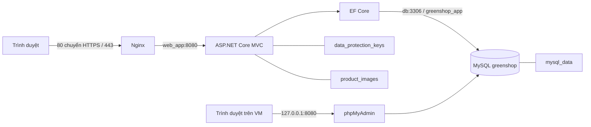

# GreenShop — Đề tài số 9: Website thương mại điện tử

Đồ án môn **Triển khai và Quản trị Hệ thống Phần mềm**. Sinh viên: **Đặng Quốc Trung**, MSSV **DTC245200016**, ICTU.

GreenShop bán cây cảnh và vật tư làm vườn. M1 gồm ứng dụng ASP.NET Core MVC, MySQL, phpMyAdmin, Docker Compose và Nginx HTTPS. Hai cổng nghiệm thu được theo dõi riêng: `M1_READY` cho hạ tầng/luồng mua hàng và `PRODUCT_READY` cho toàn bộ review, notification và Hybrid Chat. Kết quả hiện hành nằm trong báo cáo evidence.

## 1. Chức năng hiện có

| Khách hàng | Quản trị viên |
|---|---|
| Trang chủ với sản phẩm tự trượt/kéo bằng chuột; danh mục, tìm kiếm, chi tiết sản phẩm | Sản phẩm, danh mục và upload ảnh |
| Đăng ký/đăng nhập, giỏ hàng theo tài khoản, mua ngay, đặt hàng | Quản lý người dùng, vai trò, khóa tài khoản và thu hồi phiên |
| COD, VietQR chuyển khoản **xác nhận thủ công**, phí vận chuyển | Vòng đời đơn hàng, kiểm soát tồn kho, ghi chú và lịch sử thao tác |
| Lịch sử/chi tiết đơn riêng của mình | Dashboard từ dữ liệu thật, biểu đồ tương tác, xuất Excel |
| Trạng thái chuyển khoản và đơn hàng | Cài đặt ngân hàng, phí ship và ngưỡng miễn phí ship |
| Review từ đơn hoàn tất: 1–5 sao, sửa nội dung, tối đa 5 ảnh | Ẩn/hiện review; rating chỉ tính bản hiện hành công khai |
| Widget nổi có hai tab AI / chat cửa hàng, Light/Dark | Hộp thư chung, tiếp nhận theo phiên bản, Waiting/InProgress/Resolved |
| Tin nhắn lưu MySQL, SignalR cập nhật và đồng bộ lại khi reconnect | Notification Order/Review/Message lưu read/unread riêng từng Admin |

VietQR không tự xác minh giao dịch ngân hàng. Khách báo đã chuyển khoản không làm đơn thành “Đã thanh toán”; Admin kiểm tra giao dịch rồi xác nhận. Giá trị đơn đã giao trên Dashboard gồm phí ship đã lưu, nhóm theo ngày đặt hàng GMT+7; không đồng nghĩa doanh thu thực thu/lợi nhuận.

## 2. Công nghệ và kiến trúc

| Thành phần | Công nghệ |
|---|---|
| Web | .NET 8, ASP.NET Core MVC, Razor; Bootstrap, Font Awesome, font Be Vietnam Pro phục vụ nội bộ |
| Truy cập dữ liệu | EF Core 8, Pomelo MySQL, migrations |
| Database / quản trị | MySQL 8 / phpMyAdmin |
| Triển khai | Docker Engine, Docker Compose plugin |
| Reverse proxy / HTTPS | Nginx, chứng chỉ tự ký; OpenSSL tạo chứng chỉ |



Images MySQL/Nginx/phpMyAdmin và base .NET SDK/runtime được pin digest trong Compose/Dockerfile. Khi cập nhật bản vá, xác minh digest/kiến trúc và thử QA trước; không đổi major MySQL trên volume hiện hữu.

Bốn service là `db`, `web_app`, `nginx`, `phpmyadmin`, kết nối bằng Docker DNS trong `app_net`. Nginx phân giải lại `web_app` khi IP container đổi; không dùng IP container cố định. `resolve` trong upstream cần Nginx từ **1.27.3**; kiểm tra version nếu dùng image khác.

## 3. Cấu trúc thư mục

```text
.
├── backend/
│   ├── .dockerignore
│   └── GreenShop.Web/
│       ├── Areas/Admin/           # Controller/View quản trị
│       ├── Controllers/           # Storefront, giỏ hàng, thanh toán, tài khoản
│       ├── Data/                  # DbContext và danh sách ngân hàng
│       ├── Migrations/            # Lịch sử schema EF Core
│       ├── Models/, Services/, ViewComponents/, Views/
│       ├── wwwroot/               # CSS, JS, font và thư viện giao diện
│       ├── Dockerfile             # Dockerfile thực tế, context ./backend
│       └── GreenShop.Web.csproj
├── nginx/
│   ├── default.conf              # Cấu hình thực tế mount vào conf.d
│   └── ssl/                      # cert.pem/key.pem tạo tại môi trường, không tracked
├── scripts/                      # HTTPS và bootstrap tài khoản triển khai
├── tests/                        # Hồi quy và nghiệm thu, không cần để phục vụ web
├── docs/evidence/commit1/         # Minh chứng M1 đã loại thông tin nhạy cảm
├── .env.example
├── .gitignore
├── docker-compose.yml
└── README.md
```

Không sử dụng `backend/Dockerfile` hay `nginx/nginx.conf` cũ ở cổng 3000; các file legacy đó đã được loại bỏ sau khi kiểm tra tham chiếu.

## 4. Điều kiện chạy

- Ubuntu/Linux; Docker Engine và Docker Compose **plugin** (`docker compose`, không phải `docker-compose` cũ).
- Git, OpenSSL và Python 3 (thư viện chuẩn dùng cho script triển khai).
- Cổng 80/443 còn trống; dung lượng đủ để tải image/build. Khi nghiệm thu VM còn khoảng 20 GiB trống.
- .NET SDK 8 chỉ cần khi build/kiểm thử ngoài Docker; chạy web bằng Compose không cần cài SDK trên host.
- Xác định IP thật bằng `ip -brief -4 address`. IP có thể đổi sau khi đổi mạng VMware/DHCP.

| Cổng host | Binding | Mục đích |
|---|---|---|
| 80 / 443 | Host | Nginx là điểm truy cập website từ Windows/VM |
| 8080 | `127.0.0.1` | phpMyAdmin trên VM; không truy cập trực tiếp bằng IP VM từ Windows |
| 3306 | `127.0.0.1` | MySQL cho công cụ cục bộ; web dùng `db:3306` nội bộ |
| 5000 | `127.0.0.1` | Backend chẩn đoán cục bộ; trình duyệt dùng HTTPS qua Nginx |

## 5. Triển khai từ bản clone mới

```bash
git clone https://github.com/dtc245200016/GreenShop.git
cd GreenShop
cp .env.example .env
chmod 600 .env
openssl rand -hex 32
openssl rand -hex 32
```

Sửa `.env`: đặt hai giá trị sinh ngẫu nhiên **khác nhau** cho `MYSQL_ROOT_PASSWORD` và `MYSQL_APP_PASSWORD`. Mỗi giá trị hex có 64 ký tự. Không giữ placeholder, không đưa mật khẩu lên Git hoặc ảnh báo cáo. Database cố định là `greenshop`; user ứng dụng là `greenshop_app`.

Tạo chứng chỉ với IP hoặc hostname sẽ dùng trong trình duyệt:

```bash
ip -brief -4 address
bash scripts/generate-dev-cert.sh <IP_HOAC_HOSTNAME_THUC_TE>
docker compose config --quiet
docker compose build web_app
docker compose up -d --wait --wait-timeout 120 db
bash scripts/bootstrap-db-user.sh
docker compose up -d --wait --wait-timeout 120
```

Thay `<IP_HOAC_HOSTNAME_THUC_TE>` bằng giá trị thật; **không nhập dấu `< >`**. Ví dụ IP quan sát tại lần nghiệm thu là `192.168.197.128`, không phải IP bắt buộc của cấu hình.

MySQL tạo database và app user khi volume còn rỗng. `bootstrap-db-user.sh` cũng hỗ trợ volume đã có: xác minh/tạo `greenshop_app`, cấp quyền trong đúng schema, không đổi mật khẩu root, không sửa bảng nghiệp vụ, không reset schema. Nếu app user đã tồn tại nhưng mật khẩu/quyền không khớp, script dừng; không tự thay mật khẩu hoặc thu hồi quyền của tài khoản đó.

Lần đầu với bảng `Users` **rỗng**, tạo Admin bằng công cụ triển khai:

```bash
bash scripts/create-initial-admin.sh
```

Công cụ hỏi tên/email/mật khẩu qua terminal, giấu mật khẩu và lưu bcrypt; không có tài khoản/mật khẩu mặc định. Nó từ chối khi đã có bất kỳ User nào, không sửa role/password hiện có. Vì vậy tạo Admin **trước khi đăng ký khách hàng** trên bản cài mới. Với hệ thống đã có người dùng, dùng Admin hiện hữu, không chạy lại công cụ này.

Mở:

- Website: `https://<IP_VM>/` hoặc hostname đúng SAN. Đăng nhập Admin tại `/Admin/Account/Login`; khách hàng tại `/Account/Login`.
- Trên trình duyệt **của VM**: `http://127.0.0.1:8080/` để dùng phpMyAdmin. Server là `db`; đăng nhập thủ công bằng `greenshop_app` và mật khẩu app trong `.env`, hoặc root khi cần quản trị. Không có auto-login/bypass authentication.
- Bản cài mới chưa có sản phẩm: Admin tạo danh mục/sản phẩm và upload ảnh bằng web. Không seed doanh thu/đơn hàng giả.

### Truy cập phpMyAdmin từ Windows

Phương án mặc định đã nghiệm thu là trình duyệt trên VM. Nếu cần từ Windows, dùng OpenSSH và tài khoản SSH thật của VM:

```powershell
ssh -N -L 18080:127.0.0.1:8080 trung@<IP_VM>
```

Giữ terminal mở rồi truy cập `http://127.0.0.1:18080/` trên Windows. Cần SSH của VM đang hoạt động và chứng thực được. Kiểm thử xuyên từ máy Windows cần thực hiện tại máy đó; không coi việc cổng 22 mở là bằng chứng tunnel đã hoạt động. Không mở MySQL/phpMyAdmin ra mọi giao diện để xử lý một lỗi tunnel.

### Cập nhật hệ thống đã có

Sao lưu trước; giữ nguyên mật khẩu root của volume đã khởi tạo. Bổ sung `MYSQL_APP_PASSWORD` riêng vào `.env`, build, chờ DB hiện tại healthy, chạy bootstrap, rồi cập nhật:

```bash
docker compose config --quiet
docker compose build web_app
bash scripts/bootstrap-db-user.sh
docker compose up -d --wait --wait-timeout 120
```

Đổi `.env` không tự đổi mật khẩu trong MySQL đã có dữ liệu. Khi Compose thay cấu hình container, named volumes vẫn được giữ; không dùng `down -v`, không prune volume và không reset migration history.

## 6. Database, migrations và dữ liệu bền vững

Web áp dụng `Database.Migrate()` **trước khi mở cổng phục vụ**. Tám migrations hiện có tạo schema và cấu hình singleton ban đầu; không có seed User/sản phẩm/đơn hàng. Không cần chạy SQL khởi tạo lại trên database đang dùng.

`greenshop_app` có quyền trong **`greenshop.*`**, gồm DDL để startup migrations hoạt động; không có quyền quản trị user/server hoặc đọc `mysql.user`. Đây chưa phải runtime user chỉ có DML. Tách migration credentials khỏi runtime và thu hẹp DDL là hạng mục hardening tiếp theo.

Kiểm tra chỉ đọc:

```bash
docker compose exec -T db sh -c 'MYSQL_PWD="$MYSQL_ROOT_PASSWORD" mysql -uroot --database="$MYSQL_DATABASE" -e "SHOW TABLES; SELECT MigrationId FROM __EFMigrationsHistory ORDER BY MigrationId;"'
```

Schema gồm `Users`, `Categories`, `Products`, `CartItems`, `Orders`, `OrderItems`, `OrderStatusHistories`, `PaymentShippingSettings`, `HomeSliderSettings`, `ProductReviews`, `ShopConversations`, `ShopMessages`, `AdminNotifications`, `ShopConversationReads` và `__EFMigrationsHistory` (15 bảng).

Migration mới `20261014165031_CompleteCustomerEngagement` bổ sung metadata review/assignment và hai bảng notification/read receipt. Nếu một khách có nhiều review cùng sản phẩm, bản có `CreatedAt` mới nhất (rồi `Id` lớn nhất) là hiện hành; các bản cũ và đường dẫn ảnh được giữ. Unique `(UserId, CurrentProductId)` dùng generated column VIRTUAL, chỉ áp dụng bản hiện hành, tương thích FK `ON DELETE SET NULL`. Không xóa review hoặc sửa bảy migration đã áp dụng. Rating công khai chỉ tính `IsCurrent && !IsHidden`.

Trước cập nhật hệ thống thật: backup database và volumes keys/images, thử nâng cấp trên QA clone, xác minh không mất cột/dòng cũ rồi mới triển khai trong thời gian bảo trì. MySQL DDL không transactional: nếu nâng cấp bị ngắt giữa chừng, dừng và đối chiếu schema với migration; không chạy lại mù quáng hoặc dùng `Down` làm rollback dữ liệu. Phương án rollback là giữ image trước và khôi phục backup sang môi trường phục hồi riêng, xác minh trước khi chuyển traffic. Phiên kiểm toán này giữ Main chỉ đọc; đối chiếu migration đang chạy với source trước khi deploy.

| Volume | Dữ liệu | Mount trong container |
|---|---|---|
| `mysql_data` | MySQL, schema và records | `/var/lib/mysql` |
| `data_protection_keys` | Key ring cho cookie/CSRF/TempData | `/app/keys` |
| `product_images` | Ảnh upload và ảnh còn được đơn cũ tham chiếu | `/app/wwwroot/uploads/products` |

Tên volume thực tế có prefix project Compose. Giữ cùng project/thư mục khi cập nhật; kiểm tra `docker volume ls`/`docker inspect` trước khi đổi project name. Không xoá key ring để “sửa đăng nhập”.

Sao lưu database vào thư mục riêng ngoài repository:

```bash
backup_dir="$HOME/greenshop-backups"
mkdir -p "$backup_dir"
chmod 700 "$backup_dir"
umask 077
docker compose exec -T db sh -c 'MYSQL_PWD="$MYSQL_ROOT_PASSWORD" exec mysqldump -uroot --single-transaction --no-tablespaces --set-gtid-purged=OFF greenshop' > "$backup_dir/greenshop-$(date +%Y%m%d-%H%M%S).sql"
```

Backup chứa dữ liệu tài khoản/khách hàng, phải giữ riêng và không commit. Đồng thời có phương án lưu an toàn hai volume keys/images trước khi chuyển host; không restore đè vào hệ thống đang chạy chỉ để kiểm thử.

## 7. HTTPS tự ký

Script nhận IP/DNS, ghi SAN đúng loại, bổ sung loopback để kiểm tra cục bộ, sinh RSA-2048/SHA-256 và key mode `600`. Mặc định **từ chối ghi đè** bất kỳ cert/key hiện có. Chỉ khi chủ động đổi địa chỉ/gia hạn:

```bash
bash scripts/generate-dev-cert.sh <DIA_CHI_MOI> --force
docker compose exec nginx nginx -t
docker compose exec nginx nginx -s reload
```

Chứng chỉ đang dùng tại nghiệm thu có SAN đúng IP VM và được giữ nguyên. Tự ký gây cảnh báo trình duyệt vì không có CA tin cậy; kiểm tra fingerprint/chứng chỉ trước khi chấp nhận trong môi trường đồ án. Không sử dụng chứng chỉ này cho TLS public production. Khi truy cập localhost với chứng chỉ cũ chỉ có IP VM, cảnh báo sai SAN là đúng; dùng địa chỉ khớp SAN.

```bash
openssl x509 -in nginx/ssl/cert.pem -noout -subject -dates -ext subjectAltName
openssl x509 -in nginx/ssl/cert.pem -noout -checkip <IP_VM>
```

Không chia sẻ `key.pem`; cert/key runtime đều bị `.gitignore` loại khỏi Git. Nginx dùng TLS 1.2/1.3, không thêm CSP hoặc HSTS mạnh làm khó demo tự ký.

## 8. Xác minh sau triển khai

```bash
docker compose config --quiet
docker compose ps
docker compose exec nginx nginx -v
docker compose exec nginx nginx -t
curl -I http://<IP_VM>/
curl -kI https://<IP_VM>/
curl --cacert nginx/ssl/cert.pem -I https://<IP_VM>/
curl -k https://<IP_VM>/health/ready
curl -I http://127.0.0.1:8080/
docker compose exec web_app dotnet GreenShop.Web.dll --healthcheck
docker compose logs --tail=50 web_app nginx db
```

Kỳ vọng: bốn service running/healthy; HTTP 301 giữ path/query sang HTTPS; trang chủ HTTPS 200; readiness `ready`; phpMyAdmin hiển thị login và xem được DB sau đăng nhập; không 502/redirect loop. `-k` chỉ phục vụ kiểm thử cert tự ký tại môi trường này; lệnh `--cacert` kiểm tra trust/SAN đúng thật.

Headers HTTPS: `X-Frame-Options: SAMEORIGIN`, `X-Content-Type-Options: nosniff`, `Referrer-Policy: strict-origin-when-cross-origin`; Nginx không công bố version. Web readiness truy vấn `SELECT 1`; CLI probe trong container trả nonzero khi DB/web không sẵn sàng. Nginx probe kiểm tra HTTPS → web → DB. phpMyAdmin probe kiểm tra HTTP; kết nối SQL được xác minh riêng sau đăng nhập.

Thử recreate **chỉ web** trong khoảng có thể chịu gián đoạn ngắn:

```bash
docker compose up -d --no-deps --no-build --pull never --force-recreate --wait --wait-timeout 120 web_app
curl -kI https://<IP_VM>/
```

Không restart Nginx để che lỗi stale upstream; xác nhận Nginx tự phân giải IP mới. Không recreate/xóa DB chỉ để thử proxy.

## 9. Kiểm thử và minh chứng

`tests/` là công cụ phát triển, không phải dependency phục vụ web. **Đọc script trước khi chạy**: một số test viết dữ liệu, không được chạy tất cả lên `greenshop` thật. Các business tests dùng Compose/MySQL QA riêng, dữ liệu synthetic và ảnh/keys riêng; production chỉ đọc.

Nghiệm thu M1 dùng `tests/m1_acceptance.py`; xem [kết quả hiện hành](docs/evidence/commit1/commit1-verification.md). Chạy từ thư mục repo có Main đang chạy và `.env` hợp lệ; QA tự dùng project riêng, DB `greenshop_order_qa`, password mới, volumes/keys/images/TLS riêng, cổng loopback 18543/18580/18581. Không chạy song song hai QA trên các cổng này. `prepare` copy các file Git-visible ở working tree sang thư mục sạch, loại ignored files/bin/obj/secrets/uploads; bao gồm thay đổi chưa commit. `prepare` tự chụp baseline Main chỉ đọc trước phép ghi QA; từ chối ghi đè baseline và source copy cũ. `cold` build không cache và khởi động đủ bốn service; không dùng image Main. Muốn chạy hai QA song song phải dùng QA directory mới, `GREENSHOP_QA_HTTPS_PORT`, `GREENSHOP_QA_HTTP_PORT`, `GREENSHOP_QA_PMA_PORT` và `GREENSHOP_QA_SUBNET` khác nhau.

```bash
# Cần Python venv, .NET SDK 8, Docker, OpenSSL, curl và Chromium dependencies.
export GREENSHOP_QA_DIR="$(mktemp -d /tmp/greenshop-release-XXXXXXXX)"
python3 -m venv "$GREENSHOP_QA_DIR/venv"
"$GREENSHOP_QA_DIR/venv/bin/pip" install bcrypt==5.0.0 playwright==1.64.0
export PLAYWRIGHT_BROWSERS_PATH="$GREENSHOP_QA_DIR/browsers"
"$GREENSHOP_QA_DIR/venv/bin/python" -m playwright install chromium
python3 tests/m1_acceptance.py prepare
python3 tests/m1_acceptance.py certificates
"$GREENSHOP_QA_DIR/venv/bin/python" tests/m1_acceptance.py cold
"$GREENSHOP_QA_DIR/venv/bin/python" tests/m1_acceptance.py regression business
"$GREENSHOP_QA_DIR/venv/bin/python" tests/m1_acceptance.py regression security
"$GREENSHOP_QA_DIR/venv/bin/python" tests/m1_acceptance.py regression engagement
"$GREENSHOP_QA_DIR/venv/bin/python" tests/m1_acceptance.py regression hybrid
"$GREENSHOP_QA_DIR/venv/bin/python" tests/m1_acceptance.py regression contracts
"$GREENSHOP_QA_DIR/venv/bin/python" tests/m1_acceptance.py regression ai-widget
"$GREENSHOP_QA_DIR/venv/bin/python" tests/m1_acceptance.py regression inputs
"$GREENSHOP_QA_DIR/venv/bin/python" tests/m1_acceptance.py regression fractional
"$GREENSHOP_QA_DIR/venv/bin/python" tests/m1_acceptance.py regression responsive
"$GREENSHOP_QA_DIR/venv/bin/python" tests/m1_acceptance.py resilience
"$GREENSHOP_QA_DIR/venv/bin/python" tests/m1_acceptance.py browser-evidence
```

Trên Ubuntu thiếu `ensurepip`, cài gói `python3-venv` trước. Nếu Playwright thiếu thư viện hệ điều hành, dùng hướng dẫn dependency chính thức hoặc `playwright install --with-deps chromium` với quyền quản trị; không giả định `/tmp` cũ có browser/packages.

```bash
dotnet restore backend/GreenShop.Web
dotnet build backend/GreenShop.Web -c Release
dotnet run --project tests/AiProviderCheck -c Release
# EF CLI version phù hợp EF Core 8, không cần DB thật cho model check.
dotnet tool install dotnet-ef --version 8.0.0 --tool-path "$GREENSHOP_QA_DIR/ef"
export GREENSHOP_EF_DLL="$GREENSHOP_QA_DIR/ef/.store/dotnet-ef/8.0.0/dotnet-ef/8.0.0/tools/net8.0/any/dotnet-ef.dll"
ConnectionStrings__DefaultConnection='Server=localhost;Database=greenshop_design;Uid=unused;Pwd=unused' dotnet "$GREENSHOP_EF_DLL" migrations has-pending-model-changes --project backend/GreenShop.Web --configuration Release
"$GREENSHOP_QA_DIR/venv/bin/python" tests/m1_acceptance.py migration
# Chỉ đọc Main: exact migration IDs có thể FAIL nếu Main chưa được cập nhật.
python3 tests/m1_acceptance.py main
python3 tests/m1_acceptance.py preservation
# Guard kiểm tra project/container/mount trước khi chỉ dừng QA; giữ volumes.
python3 tests/m1_acceptance.py teardown
```

Các script QA dùng chung `qa_support.py` và biến `GREENSHOP_QA_DIR`; hash snapshot khám phá mọi bảng, không giả định khóa `Id`. Các wrapper `prepare/upgrade` cũ đã trỏ về runner hiện hành; không cần image baseline có tên cố định. Mode tái hiện lỗi cookie đã sửa và capture cookie từ schema lịch sử dừng với lý do rõ ràng; chúng cần archived source và không được ghi PASS cho source hiện tại. Migration regression hiện hành là mode `migration` ở trên. Credentials, SQL backup, cookies và log thô chỉ lưu ở QA directory ngoài Git; chỉ copy evidence đã loại secrets. Không dùng `down -v` để cleanup. M1 evidence không phải benchmark tải lớn hoặc kiểm toán bảo mật toàn diện.


Trước release Main, `release-rehearsal` chạy trên một **QA directory/project mới**, ports/subnet chưa dùng. Lệnh tạo backup MySQL/uploads/Data Protection/TLS/`.env`/runtime image trong `backups/release-*` bị ignore (thư mục 700, file 600), xác minh SHA-256/OCI blobs, boot runtime cũ từ bản restore, upgrade 7→8 rồi restore độc lập về trạng thái backup trên QA. Không chạy lệnh này trên QA đã có dữ liệu. Backup không tự xóa; cần giữ bản ngoài máy theo chính sách vận hành. Chỉ sau khi rehearsal đạt và người vận hành phê duyệt mới áp dụng migration/recreate Main; không downgrade EF hoặc reset dữ liệu khi rollback.

```bash
# Set GREENSHOP_QA_DIR plus unused GREENSHOP_QA_*_PORT / GREENSHOP_QA_SUBNET first.
python3 tests/m1_acceptance.py release-rehearsal
```

### AI tùy chọn và SignalR

Provider Gemini Native dùng `POST https://generativelanguage.googleapis.com/v1beta/models/{model}:generateContent` qua typed `HttpClient` và `IAiChatProvider` hiện có. Theo chính sách chỉ dùng miễn phí, runtime chỉ cho Gemini đã xác minh Free Tier; nhánh OpenAI có sẵn được giữ để tương thích source nhưng bị chặn bởi policy, không thể bật qua cấu hình; không fallback giữa provider/model, không SDK mới, không tự retry/bật billing. [Google API reference](https://ai.google.dev/api/generate-content), [model discovery](https://ai.google.dev/api/models), [rate limits](https://ai.google.dev/gemini-api/docs/rate-limits), [pricing](https://ai.google.dev/gemini-api/docs/pricing).

Cấu hình server bằng `.env` bị ignore: `AI_CHAT_ENABLED`, `AI_CHAT_PROVIDER=Gemini`, `AI_CHAT_MODEL`, `GEMINI_API_KEY`, `AI_CHAT_TIMEOUT_SECONDS` (2–60), `AI_CHAT_REQUESTS_PER_MINUTE` (1–10, mặc định 5, dùng chung toàn instance và theo IP), `AI_CHAT_MAX_OUTPUT_TOKENS` (100–2000, mặc định 500), `AI_CHAT_HISTORY_TURNS` (1–4). `AI_CHAT_API_KEY` vẫn là secret tùy chọn cho provider được chọn. Model không có default; dùng ID đã kiểm tra bằng key/project thực, không chép tên từ ví dụ tài liệu. Báo cáo nghiệm thu trước ghi nhận `gemini-3.5-flash-lite` được key liệt kê và trả lời thật 4 lượt; đợt hoàn thiện floating widget này không gọi thêm generation thật và không tính mock thành live PASS. Người dùng đã đối chiếu chính key trong `.env` với Default Gemini Project và xác nhận Free Tier chưa bật billing. Không suy ra billing tier từ danh sách model. Có 2 kiểm tra từ chối cục bộ không gọi model; AI QA được tắt lại sau thử nghiệm. Quyền/quota cần kiểm tra lại khi thay project/model. Khi chưa cấu hình đầy đủ, để `Enabled=false`; tab AI báo chưa khả dụng còn live chat vẫn hoạt động.

Lịch sử AI nằm trong token Data Protection có xác thực/mã hóa, ràng buộc cookie HttpOnly + tài khoản/session, hết hạn 30 phút; tối đa 4 cặp hỏi/đáp và 6000 ký tự, tự loại cặp cũ. Token không được ghi MySQL/localStorage hoặc gửi cho Admin; browser giữ transcript/token đã mã hóa trong sessionStorage tối đa 30 phút, dùng khóa phân vùng theo browser/tài khoản/session do server cấp. Không dùng localStorage cho transcript; không gửi AI transcript cho Admin. Giá trong thẻ không được phục hồi từ cache sau reload; lần hỏi tiếp theo lấy lại DB. Câu hỏi tối đa 1000 ký tự, đáp án 2000, request 128 KiB, response upstream 64 KiB; concurrency Gemini tối đa 2, không xếp hàng; nhóm endpoint có limiter vẫn giữ cổng concurrency 8. Nút “Cuộc trò chuyện mới” xóa context phía browser. Giới hạn/rate counters là trong bộ nhớ của một instance; restart làm mới limiter. Câu hỏi và context công khai được gửi provider; không gửi tài khoản, đơn riêng, credentials hoặc live chat.

Retrieval SQL lọc catalog đang hoạt động/còn hàng, ngân sách tiếng Việt và từ khóa trong tên/mô tả/danh mục, tối đa 6 sản phẩm. Đây là tìm kiếm từ khóa, chưa phải semantic/vector search. Context có mô tả/danh mục/giá/tồn kho/rating/review count và chính sách phí giao hàng công khai. Model trả advice + product IDs; ID ngoài context bị từ chối. Backend đọc lại DB sau khi chờ model; thẻ giá/tồn kho/rating/link và phí giao hàng luôn do server tạo. Render plain text; không chạy HTML/link từ model. Các mẫu thông tin thương mại/nội dung nguy hiểm bị từ chối, nhưng bộ lọc và prompt không chứng minh mọi diễn đạt tự nhiên đều đúng; cần nghiệm thu live bằng tình huống thực. Yêu cầu dữ liệu riêng/giao dịch và chính sách/khuyến mãi chưa có dữ liệu được backend hướng sang cửa hàng trước khi gọi model.

Thiếu model/key, 400/401/403/404/429/5xx, timeout/cancel, blocked/empty candidates, sai kiểu JSON và body quá lớn đều trả thông báo an toàn; không trả raw provider payload. Log chỉ provider/model/duration/category/token usage và rate-limit hits. Không log câu hỏi, response, key hoặc headers. `dotnet run --project tests/AiProviderCheck -c Release` chạy mocked HTTP tests; `regression ai-widget` kiểm tra UX bằng HTTP mock và không được tính là live Gemini. Test generation thực cần xác nhận tier/ngân sách và cap request; không dùng key thật để thử hàng loạt lỗi.


SignalR client 8.0.7 được self-host kèm MIT license. Hub `/supportHub` chỉ Customer; `/Admin/supportHub` chỉ Admin, kiểm tra cùng origin, group dựa vào quyền sở hữu và session DB. Gửi/đọc tin vẫn qua POST có antiforgery, persist trước khi broadcast. Reconnect join lại group và đồng bộ theo message ID; unique RequestToken ngăn gửi trùng. Hub chỉ gửi invalidation, nội dung được đọc qua HTTP kiểm tra session mới. Có sync dự phòng 30 giây; không dùng polling 5 giây làm realtime. Chạy một web instance; chưa có SignalR backplane, không scale nhiều instance tùy tiện. Nginx đã có WebSocket Upgrade/Connection và Docker DNS, không cần mở cổng mới.

Admin tự tiếp nhận cuộc trò chuyện Waiting, chỉ Admin phụ trách được trả lời/đóng; hai người nhận cùng Version chỉ một người thành công. Khách gửi lại sau Resolved sẽ đưa cuộc trò chuyện về Waiting. Notification read/unread và con trỏ đọc tin nhắn tách theo Admin; số đơn Pending vẫn là chỉ số vận hành riêng. Không tạo notification hồi tố cho event cũ. Cursor Admin toàn cục cũ được giữ làm lịch sử; cursor từng Admin mới bắt đầu riêng, không đoán ai đã đọc tin trước nâng cấp.

## 10. Xử lý sự cố

| Triệu chứng | Kiểm tra / xử lý |
|---|---|
| Thiếu `.env` / Compose không validate | Copy mẫu, điền hai secret khác nhau, chạy `config --quiet`; không công khai config đã resolve |
| Build lỗi | Xem lỗi đầu tiên, dung lượng và kết nối NuGet/MCR; chạy `docker compose build web_app`, không bỏ qua build fail |
| MySQL unhealthy | Xem logs, kiểm tra mật khẩu root đúng volume hiện tại và truy vấn healthcheck; không xóa volume |
| Web không kết nối DB | DB healthy, user `greenshop_app` đúng mật khẩu/grants; chạy bootstrap để xác minh, không tự đổi root password |
| Nginx thiếu certificate | Chạy script tạo cert trên host, kiểm tra mount `nginx/ssl`, tên `cert.pem/key.pem` và `nginx -t` |
| Nginx 502 | Web/DB readiness, startup migrations, Docker DNS, upstream 8080, version hỗ trợ `resolve`; xem logs, không hardcode IP/restart để che lỗi |
| Browser cảnh báo SSL | Tự ký/địa chỉ không khớp SAN/đã hết hạn; dùng đúng IP/hostname và kiểm tra cert, không tắt HTTPS |
| phpMyAdmin không mở từ Windows | Port 8080 chỉ bind loopback VM; dùng trình duyệt VM hoặc tunnel SSH. `127.0.0.1` trên Windows là máy Windows |
| phpMyAdmin login lỗi | Server `db`, đúng user/password và DB healthy; không cấu hình auto-login hoặc password rỗng |
| Mất quyền sau deploy | Giữ volume key ring; kiểm tra User IsActive/Role/SessionVersion. Admin và khách hàng dùng hai cookie riêng |
| Tạo Admin ban đầu bị từ chối | Công cụ chỉ áp dụng Users rỗng; dùng Admin hiện có. Không sửa role/reset password thật để vượt kiểm tra |

## 11. Milestone và hardening

| Mốc | Phạm vi | Trạng thái |
|---|---|---|
| M1 / Commit 1 | App + MySQL + phpMyAdmin + Compose + Nginx HTTPS, hướng dẫn và nghiệm thu | Đối chiếu verdict trong minh chứng M1 |
| M2 / Commit 2 | Prometheus + Grafana, metrics web/database/container | Chưa triển khai |
| M3 / Commit 3 | Loki + Promtail + LogQL | Chưa triển khai |

M1 giữ tên service/network rõ ràng và Docker stdout/stderr để phát triển M2/M3. Không thêm exporter, metrics endpoint hay stack monitoring/logging vào M1.

Baseline: secrets từ `.env`, app DB user giới hạn schema, cookie HTTPS/CSRF/role checks, giới hạn đăng nhập, cổng dữ liệu bind localhost, named volumes và TLS/security headers. Web vẫn chạy root vì key ring hiện hữu mode 700/root; chuyển non-root cần kế hoạch ownership cho đúng volume và kiểm thử ghi ảnh/keys, không `chown -R` dữ liệu thật. Network hiện dùng một bridge, chưa tách frontend/backend. Tách user migrations/runtime, non-root, network và firewall host là các phần hardening tiếp theo; không mặc định coi môi trường demo là public production.

Không commit `.env`, TLS private key, database dump, runtime uploads, key ring, cookies hay dữ liệu khách hàng. Không Git commit/push tự động trong nghiệm thu; người dùng kiểm tra rồi quyết định chốt Commit 1.

Tài liệu bổ sung: [SignalR client/reconnect](https://learn.microsoft.com/en-us/aspnet/core/signalr/javascript-client?view=aspnetcore-8.0), [OpenAI Responses](https://developers.openai.com/api/docs/guides/text), [MySQL generated columns](https://dev.mysql.com/doc/refman/8.0/en/create-table-generated-columns.html).

Tài liệu kỹ thuật: [MySQL Official Image](https://hub.docker.com/_/mysql), [Nginx upstream/DNS](https://nginx.org/en/docs/http/ngx_http_upstream_module.html), [OpenSSL req/SAN](https://docs.openssl.org/3.5/man1/openssl-req/), [ASP.NET readiness](https://learn.microsoft.com/en-us/aspnet/core/host-and-deploy/health-checks?view=aspnetcore-8.0).

Widget nổi dùng chung launcher và các nút `data-chat-mode="shop"`; launcher luôn mở tab AI, nút Chat với Shop mở thẳng tab Shop; lịch sử từng chế độ vẫn độc lập khi chuyển tab. Route cũ `/TuongTac/TroChuyen` chỉ redirect về `/?chat=shop`; JS mở panel rồi xóa riêng intent này bằng replaceState. `Views/Shared/ShopChat.cshtml` vẫn cần cho Admin Inbox, không xóa. Enter gửi, Shift+Enter xuống dòng; panel không modal, Escape thu gọn và trả focus, kế thừa theme/safe-area/visual viewport. Chỉ mở SignalR Customer khi Shop panel hiển thị; đóng/mở không tạo thêm connection.

Chính sách Free Tier: mặc định AI tắt. Chỉ bật sau khi xác minh key thuộc đúng project chưa bật billing, model có Free Tier và quota hiện tại. Cần `AI_CHAT_FREE_TIER_VERIFIED=true`, `AI_CHAT_FREE_TIER_VERIFIED_MODEL` khớp model và `AI_CHAT_FREE_TIER_VERIFIED_UNTIL` là thời điểm UTC còn hiệu lực; các flag cấu hình là xác nhận của operator, không thay thế bằng chứng billing/key-project. Không tự điền các giá trị này hoặc đổi `.env` Main. Quota do người dùng xác nhận ngày 15/10/2026: model `gemini-3.5-flash-lite`, project Default Gemini Project Free Tier, 15 RPM / 250.000 TPM / 500 RPD; người dùng đã xác nhận đối chiếu chính key trong `.env` khớp project này trên AI Studio. Đây là xác nhận của chủ project; host không có Cloud credentials để độc lập đọc metadata key–project/billing. Thành công generation không chứng minh billing tier.

Ngân sách bảo thủ mặc định: 5 RPM chung, 30.000 token/phút, 20 request/24 giờ, 100.000 token/24 giờ; input tối đa 12.000 đơn vị ngân sách và output 500 token. Token đầu vào được chặn/reserve theo UTF-8 request bytes + margin 512, cộng toàn output cap, không gọi countTokens. Request lỗi cũng tiêu ngân sách; provider 429 mở cooldown 60 giây, không retry/fallback. Counters là rolling window trong RAM của một instance và reset khi restart; không đại diện usage của các ứng dụng khác dùng cùng project. Không bật AI khi chưa xác minh project/quota; quota của Google vẫn là cổng cuối. Tính năng Shop/SignalR độc lập với AI.


Phản hồi đánh giá: vào **Admin → Đánh giá khách hàng**, nhập nội dung 3–1500 ký tự rồi chọn **Lưu phản hồi**; những lần sau dùng **Cập nhật phản hồi**. Mỗi review có tối đa một phản hồi chính thức, hiển thị với nhãn GreenShop và thời gian cập nhật dưới review ở trang sản phẩm. Phản hồi giữ nguyên sao/count/average, đi cùng trạng thái công khai của review; bản lưu cũ chỉ đọc. Action POST Admin-only + antiforgery và version CAS chống ghi đè, Customer không thể overpost các trường reply. Migration `20261014232307_AddReviewReplies` thêm bốn cột nullable và FK Admin, không xóa review cũ. `regression review-replies` kiểm thử luồng thật trên QA, phân quyền/CSRF/stale writes/ẩn-hiện/XSS/AJAX và sáu viewport.

Quyền chủ shop gắn với tài khoản Admin có email `trungdtt123@gmail.com` (email đăng nhập không chỉnh sửa qua UI). Chỉ chủ shop được đổi quyền người dùng; Admin thông thường không được sửa/khóa Admin khác. Bootstrap trên database trống phải dùng email chủ shop này; email được dành riêng, không cho đăng ký công khai. Mỗi sản phẩm trong một đơn đã giao thành công có lượt đánh giá riêng; mua lại ở đơn mới được đánh giá mới.

Giữ và kéo nút **Chat với GreenShop** để di chuyển nút; kéo thanh tiêu đề hoặc biểu tượng lá trong cửa sổ chat để di chuyển cửa sổ. Vị trí được nhớ trên trình duyệt và giới hạn trong màn hình. Với bàn phím, dùng **Alt + phím mũi tên** trên nút chat, hoặc phím mũi tên khi focus biểu tượng lá; **Home** (nút chat: **Alt + Home**) đưa về vị trí mặc định. Khung tin nhắn Admin cuộn bằng con lăn; tin đến không kéo xuống cuối khi đang đọc lịch sử.

Migration `20261015024032_ReviewPerCompletedOrder` bỏ tính duy nhất của chỉ mục Customer/Product, giữ nguyên dữ liệu, ảnh và phản hồi. Gửi lại cùng đơn/sản phẩm không sinh thêm đánh giá; nhiều dòng cùng sản phẩm trong một đơn dùng chung lượt đánh giá. Kiểm thử `regression order-owner-chat` bao phủ đánh giá, quyền chủ shop, cuộn và kéo chat; `migration` kiểm tra nâng cấp 9→10 và từ chối hạ cấp khi các đánh giá độc lập khiến ràng buộc cũ không còn phù hợp.
