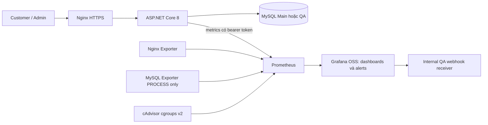

# GreenShop — Báo cáo nghiệm thu Milestone 2

Ngày kiểm thử: 16/10/2026, giờ Việt Nam (UTC+7). Repository: `https://github.com/dtc245200016/GreenShop-Official.git`.

## A. Verdict

**M2_READY=YES trong phạm vi đã thống nhất: nghiệm thu chức năng và sự cố trên QA cách ly; Main chỉ smoke tests không cần credentials ứng dụng.** Không coi các bài đăng nhập Customer/Admin trên Main là đã kiểm thử.

| Tiêu chí | Kết quả |
|---|---|
| `SOURCE_READY` | YES |
| `PROMETHEUS` | PASS |
| `GRAFANA` | PASS |
| `CADVISOR` | PASS |
| `NGINX_EXPORTER` | PASS |
| `MYSQL_EXPORTER` | PASS |
| `ASPNET_METRICS` | PASS |
| `GRAFANA_AUTH` | PASS |
| `INFRASTRUCTURE_DASHBOARD` | PASS |
| `APPLICATION_DASHBOARD` | PASS |
| `SECURITY_DASHBOARD` | PASS |
| `SECURITY_METRIC` | PASS |
| `FAILED_LOGIN_5_IN_1_MIN` | PASS |
| `GRAFANA_ALERT_FIRING` | PASS |
| `ALERT_NOTIFICATION` | PASS |
| `ALERT_RECOVERY` | PASS |
| `MAIN_DEPLOYMENT` | PASS |
| `DATA_PRESERVATION` | PASS |
| `HARDENING` | PASS |
| `QA_READY` | YES |
| `M2_READY` | YES |

Main Customer/Admin authenticated business tests: **NOT TESTED** do không có credentials; theo chỉ đạo bổ sung, không tạo, sửa, khóa hoặc xóa tài khoản ứng dụng thật. Grafana Admin là tài khoản monitoring riêng và đã kiểm thử đăng nhập thật.

## B. Implementation Summary

### Kiến trúc thực tế



Mũi tên metrics biểu diễn luồng dữ liệu; Prometheus chủ động scrape ứng dụng/exporters. Datasource Grafana truy vấn Prometheus qua mạng Docker.

Main tiếp tục dùng project **`dtc245200016_btl_tkqt_htpm`**, không tạo database Main mới. Ban đầu project chạy từ repository cũ. Sau rollout, web/Nginx/monitoring được quản lý qua kế hoạch riêng `/home/trung/.local/share/greenshop-monitoring/main/compose.json`, được sinh từ runtime đã audit và source trong repository chính thức. MySQL/phpMyAdmin vẫn là container cũ. File runtime này chứa môi trường triển khai nên không đưa vào Git.

Phiên bản đã chạy: Prometheus **3.15.0**, Grafana OSS **13.2.4**, cAdvisor **0.60.6**, mysqld_exporter **0.20.0**, nginx-prometheus-exporter **1.5.3**, prometheus-net.AspNetCore **8.2.1**. Receiver dùng Python **3.12.10 Alpine 3.21**, chỉ làm sink QA nội bộ. Không Loki/Promtail, không Grafana Cloud.

| Thành phần | Main | QA |
|---|---|---|
| Website | `https://192.168.197.128` | Ubuntu loopback HTTPS `21543` |
| Grafana | `127.0.0.1:3000` | `127.0.0.1:21300` |
| Prometheus | `127.0.0.1:9090` | `127.0.0.1:21990` |
| Exporters, receiver | Không publish host port | Không publish host port |

Mỗi stack có `monitoring_net` internal và `admin_net` riêng cho truy cập loopback của Grafana/Prometheus. Prometheus/Grafana không tham gia database network. MySQL exporter là cầu nối duy nhất cần quyền đọc trạng thái DB. Main giữ nguyên network application/database cũ để tránh thay đổi DB ngoài phạm vi; QA phân riêng application, database và monitoring networks.

Volumes Main bảo toàn:

- `dtc245200016_btl_tkqt_htpm_mysql_data`.
- `dtc245200016_btl_tkqt_htpm_product_images`.
- `dtc245200016_btl_tkqt_htpm_data_protection_keys`.

Volumes monitoring Main mới: `dtc245200016_btl_tkqt_htpm_prometheus_data`, `dtc245200016_btl_tkqt_htpm_grafana_data`. QA có volumes mang prefix `greenshop-m2-qa_`, không dùng volumes/networks/keys/TLS Main.

### Metrics và dashboard

Infrastructure lấy CPU, working-set RAM, RX/TX và last-seen từ cAdvisor; Nginx connections/request counter từ stub_status exporter; MySQL availability/connections từ global status. Container panels có bộ lọc Compose project, không gộp nhầm cùng tên service giữa Main và QA. Last-seen là độ mới quan sát, không phải restart counter.

Application dùng counter `greenshop_http_requests_total` và histogram `greenshop_http_request_duration_seconds` với buckets thật. Nhóm endpoint hữu hạn: home, authentication, admin, catalog, cart, orders, engagement, support, health, other. Không dùng URL, query string, email, IP, username hay ID làm label. 4xx/5xx lấy từ ứng dụng; Nginx OSS exporter không cung cấp phân phối status code.

Security dùng failed/successful-login counters, access-denied counter, gauge rolling 60s, biểu đồ estimate 5m và Grafana alert list thật. Dashboard JSON, datasource, provider, alert rules, contact point và routing đều provision từ file trong Git. [Runtime QA](runtime-verification.json) và [runtime Main](main-postdeploy-verification.json) kiểm tra mọi biểu thức panel trả series thật.

### Backup, triển khai và bảo toàn dữ liệu

Trước rollout đã snapshot tất cả bảng ứng dụng, migration IDs, hashes uploads/keys/TLS, container IDs/images/mounts. MySQL dump nhất quán được restore vào schema kiểm chứng trên MySQL QA và so sánh hash từng bảng. Mọi file trong archives uploads/keys/TLS khớp hash nguồn. Backup nằm trong thư mục private ngoài Git, không xuất dữ liệu khách hàng ra báo cáo.

Source không thêm/sửa migration. Main đã đối chiếu IDs trước và sau rollout. Chỉ `web_app` và `nginx` được recreate; DB/phpMyAdmin giữ nguyên ID. Biến môi trường ứng dụng cũ khớp hash sau khi loại biến mới trỏ token file. Tài khoản hệ thống `greenshop_exporter` được tạo có chủ đích với PROCESS/MAX_USER_CONNECTIONS 3; bảng Users ứng dụng không đổi.

Thời điểm Main deployment PASS: **20:52:57 16/10/2026 UTC+7**. [Kết quả Main](main-deployment.json), [kiểm chứng bảo toàn sau deploy](main-postdeploy-verification.json).

## C. Security Incident Report — GS-SEC-001

Chỉ tài khoản tổng hợp QA được dùng. Mỗi POST dùng antiforgery token và cookie thật; rate limiter, BCrypt, trạng thái tài khoản và phân quyền vẫn hoạt động. Một lần sai thông tin xác thực tăng counter đúng một lần. GET Login, lỗi validation, thiếu CSRF, login đúng và sai portal role không tăng failed-credential counter.

Hai vòng nghiệm thu độc lập, baseline security sạch:

| Vòng | Failed logins thật | Thời gian gửi | Alert startsAt | Receiver nhận firing | Receiver nhận resolved |
|---|---:|---:|---|---|---|
| 1 | 5 | 1.523 giây | 20:36:50 16/10/2026 UTC+7 | 20:36:55 16/10/2026 UTC+7 | 20:37:55 16/10/2026 UTC+7 |
| 2 | 5 | 1.564 giây | 20:38:40 16/10/2026 UTC+7 | 20:38:55 16/10/2026 UTC+7 | 20:39:55 16/10/2026 UTC+7 |

Bằng chứng: [vòng 1 firing](incident-1-firing.json), [vòng 1 resolved](incident-1-resolved.json), [vòng 2 firing](incident-2-firing.json), [vòng 2 resolved](incident-2-resolved.json). Counter tăng đúng 5 mỗi vòng; logs stdout trong khoảng hai vòng có đúng 10 `auth.login.failed` ([security events](security-events.json)). `startsAt` là timestamp do Grafana gửi, không phải thời điểm agent bắt đầu polling. `lastEvaluation` nằm trong JSON rule evidence; thời điểm receiver nhận là timestamp UTC do receiver tự ghi.

Kiểm thử biên bổ sung: 4 login sai đã được scrape và qua evaluation mà rule vẫn inactive; lần thứ 5 trong **24.758 giây** kể từ đầu đợt làm rule Firing. [Bằng chứng biên](threshold-boundary.json). Đợt chụp UI bổ sung gửi 5 lần sai thật trong **1.572 giây**, counter từ 5 lên 10, cửa sổ 60s=5. [Bằng chứng UI có dữ liệu](live-capture.json).

Rule authoritative:

```promql
sum(greenshop_auth_login_failures_last_60s) >= bool 5
```

Grafana condition A > 0, evaluation 10s, pending 0s; không hạ ngưỡng 5 thành 4. Gauge được tính từ timestamp monotonic của hành vi từ chối credentials thật. Counter tích lũy vẫn export độc lập. `increase(counter[1m])` có sampling/extrapolation nên không được dùng để tuyên bố exact event count. Panel 5m ghi rõ sampled estimate; giá trị có thể không nguyên hoặc không bằng counter delta.

Contact point **GreenShop Security Alerts** gửi webhook thật, route group theo alertname/incident, group_wait=0s, group_interval=10s, repeat=4h, gửi cả resolved. Payload có alertname, severity warning, incident GS-SEC-001, status, startsAt/endsAt, summary, generator URL và thời điểm receipt. Không dùng nút Send test notification để kết luận pipeline.

Screenshots thật: [Normal](security-alert-normal.png), [Firing](security-alert-firing.png), [Security dashboard Firing](grafana-security-firing.png), [receiver nhận payload](security-notification-received.png), [trang chụp khi chưa render](security-alert-resolved.png). Ảnh cuối bị trống và **không được dùng làm bằng chứng trạng thái Resolved**; recovery được chứng minh bằng [JSON vòng 1](incident-1-resolved.json) và [JSON vòng 2](incident-2-resolved.json), có rule inactive và notification resolved thật. Ảnh receiver chụp trực tiếp URL `/notifications` nội bộ. Không mock UI hoặc inject metric; ảnh được chụp sau khi panel truy vấn xong.

Giới hạn: đây là dấu hiệu password guessing tổng hợp, không xác định cùng IP/tài khoản và không chứng minh xâm nhập thành công. Cửa sổ nằm trong một web process, reset khi process restart; không tuyên bố exact cross-replica window. Phải scrape trước khi event cũ nhất rời cửa sổ; burst kéo dài sát 60s có thể bị bỏ lỡ do chu kỳ scrape/evaluate. Không cảnh báo tức thời.

## D. Changed Files

Sửa Program.cs để JSON console logging, DI metrics và token guard; AccountController chỉ thêm instrumentation vào nhánh invalid credentials và sau sign-in; UserSession ghi authorization denial. Không thay validation, CSRF, cookie policy, role checks hay nghiệp vụ.

Compose thêm monitoring services, secrets, networks, persistent storage, resource/log limits và loopback bindings. Nginx giữ reverse proxy/WebSocket/HTTPS, thêm private stub_status và chặn public telemetry. README Commit 1 được giữ nguyên và chỉ thêm liên kết M2. `.gitignore` chặn runtime/build/backup material.

Danh sách source/config/test tạo hoặc sửa:

- `.env.example`
- `.gitignore`
- `README.md`
- `backend/GreenShop.Web/Controllers/AccountController.cs`
- `backend/GreenShop.Web/GreenShop.Web.csproj`
- `backend/GreenShop.Web/Program.cs`
- `backend/GreenShop.Web/Services/UserSession.cs`
- `docker-compose.yml`
- `nginx/default.conf`
- `backend/GreenShop.Web/Services/Observability.cs`
- `monitoring/README.md`
- `monitoring/grafana/dashboards/greenshop-application.json`
- `monitoring/grafana/dashboards/greenshop-infrastructure.json`
- `monitoring/grafana/dashboards/greenshop-security.json`
- `monitoring/grafana/provisioning/alerting/notifications.yml`
- `monitoring/grafana/provisioning/alerting/rules.yml`
- `monitoring/grafana/provisioning/dashboards/dashboards.yml`
- `monitoring/grafana/provisioning/datasources/prometheus.yml`
- `monitoring/prometheus/prometheus.yml`
- `scripts/deploy-monitoring.py`
- `tests/monitoring/acceptance.py`
- `tests/monitoring/capture.py`
- `tests/monitoring/engagement.py`
- `tests/monitoring/faults.py`
- `tests/monitoring/main_smoke.py`
- `tests/monitoring/receiver.py`
- `tests/monitoring/regression.py`
- `tests/monitoring/requirements.txt`

Evidence được tạo trong thư mục này; xem [manifest kiểm tra](evidence-manifest.json). **Không xóa file source nào.** Không đưa dump, credentials, binary build output hay log thô ứng dụng vào Git. `build-release.txt` là build transcript, `security-events.json` chỉ chứa các security events đã giảm thiểu trường dữ liệu của QA.

## E. Test Evidence

| Test | Expected | Actual | Status | Evidence |
|---|---|---|---|---|
| Restore/build/publish | Build sạch | Host restore/build/publish PASS; Docker multi-stage restore/build/publish PASS, 0 warning/error | PASS | [build-release.txt](build-release.txt) |
| Compose validation | Source/Main/QA hợp lệ | Ba config --quiet thành công | PASS | [security-scan.json](security-scan.json), source runner |
| Prometheus targets | 5 UP, metric thật | Main và QA 5/5, không chỉ HTTP 200 | PASS | [QA targets](prometheus-targets.json), [Main](main-deployment.json) |
| Dashboard PromQL | Mỗi panel có series thật | Tất cả biểu thức trả dữ liệu | PASS | [QA](runtime-verification.json), [Main](main-postdeploy-verification.json) |
| Grafana auth | Login đúng, default/anonymous bị chặn | Chromium login thật; API admin/admin và anonymous 401 | PASS | [Main UI](main-grafana-ui.json) |
| MySQL exporter privilege | Không quyền đọc/sửa app tables | PROCESS only, SELECT và UPDATE bị từ chối | PASS | [grants](mysql-exporter-privileges.json) |
| Authentication/CSRF/role | Không đổi hành vi, không đếm sai | GET/invalid form/success không tăng failure; CSRF 400; role gate đúng | PASS | [auth](auth-regression.json), [logout](portal-logout.json) |
| Storefront | Catalog/cart/checkout/orders hoạt động | Existing HTTP suite: pagination, stock, cart ownership, COD, idempotency, race last-unit | PASS | [business](business-regression.json) |
| Admin | Trang quản trị truy cập đúng | Dashboard/products/categories/orders/users/reviews/notifications/inbox 200 | PASS | [business](business-regression.json) |
| Shipping/reviews/chat | Nghiệp vụ thật | 100k+30k=130k; real order transitions, review/reply, chat, SignalR connected | PASS | [engagement](engagement-regression.json), [UI](qa-floating-chat.png) |
| GS-SEC-001 | 5 sai → Firing → webhook → resolved | Hai vòng độc lập; không double count | PASS | Incident JSON và screenshots |
| Boundary 4/5 | 4 không Firing, 5 Firing | Đã quan sát qua scrape/evaluation | PASS | [boundary](threshold-boundary.json) |
| Availability alerts | Web/DB/5xx tự đánh giá | Stop/recover QA web và DB; readiness 503 thật; cả ba rule fire rồi normal | PASS | [faults](availability-alerts.json) |
| Persistence | Dashboard/rules/TSDB giữ sau restart | Grafana/Prometheus restart, history offset 1m còn | PASS | [persistence](persistence.json) |
| Rollback | Có thể về M1 rồi M2 không mất dữ liệu | QA dùng đúng image M1 Main, login/ready pass, quay về M2 | PASS | [rollback](rollback-rehearsal.json) |
| Backup restore | Dump/archive phục hồi hợp lệ | Table hashes và mọi archived file hash khớp | PASS | [DB](backup-verification.json), [archives](archive-verification.json) |
| Main preservation | Data/files/env/DB container giữ nguyên | Đã so sánh sau deploy | PASS | [Main verification](main-postdeploy-verification.json) |
| Public metrics | Không lộ telemetry | Nginx 404 cả khi token hợp lệ; direct app port không token 404 | PASS | [Main verification](main-postdeploy-verification.json) |
| Secrets | Không trong Git-visible source/evidence | Exact-match scan thực tế, không in secret | PASS | [scan](security-scan.json) |
| Main authenticated Customer/Admin | Chỉ test khi có credentials an toàn | Không có credentials; không tạo/sửa tài khoản thật | NOT TESTED | Phạm vi đã thống nhất |

Các lỗi được phát hiện và xử lý: Docker internal-only network không publish loopback nên tách admin bridge; YAML alias của networks tạo duplicate nên thay bằng lists riêng và validate lại; parser login cần HTML decode; suite storefront cũ cần fixture shipping=0 giống wrapper M1 và đã phục hồi phí; polling restart chờ readiness; mounts so sánh theo destination; ảnh dashboard chờ query hoàn tất. Không thay logic nghiệp vụ để che lỗi.

## F. Credentials và truy cập

Grafana username: **admin**. Mật khẩu được sinh ngẫu nhiên, không hiển thị trong báo cáo/chat/logs/screenshot. Secret Main: `/home/trung/.local/share/greenshop-monitoring/main/secrets/grafana-password`; QA tương ứng `/home/trung/.local/share/greenshop-monitoring/qa/secrets/grafana-password`. Thư mục private 0700, manifest/compose/password metadata 0600; file-backed secrets read-only trong container. Đọc trực tiếp bằng công cụ cục bộ trên VM trong phiên riêng; không gửi nội dung qua chat. Đổi password qua Grafana profile; thay startup secret không reset tài khoản đã khởi tạo. Không xóa Grafana volume để đổi mật khẩu.

Windows mở tunnel:

```powershell
ssh -N -L 3000:127.0.0.1:3000 -L 9090:127.0.0.1:9090 trung@192.168.197.128
```

Mở `http://localhost:3000`; Prometheus `http://localhost:9090`. QA dùng tunnel cổng 21300/21990/21543 như [hướng dẫn vận hành](../../../monitoring/README.md). Grafana chỉ bind loopback, cookie SameSite Strict; Secure=false phù hợp HTTP loopback trong SSH tunnel. Không mở Grafana Admin công khai.

## G. Remaining Risks / giới hạn

- Main Customer/Admin authenticated flows chưa kiểm thử bằng tài khoản thật; QA đã kiểm thử. Không suy ra Main login PASS từ việc trang login trả 200.
- Main vẫn có application/database network legacy chung. Prometheus không tham gia network này; chỉ exporter chuyên dụng cần truy cập DB. Tách lại DB network là thay đổi ngoài phạm vi đợt triển khai này.
- cAdvisor có quyền quan sát host metadata/filesystem read-only. Socket `:ro` không giới hạn Docker API method; cAdvisor vẫn là thành phần tin cậy có quyền cao. Không privileged, drop capabilities, không host port, network internal giảm exposure nhưng không biến nó thành sandbox an toàn trước collector compromise.
- Receiver là QA sink nội bộ, không phải pager production hay kênh cá nhân. Nó đang được giữ để demo và nhận notification nội bộ; restart mất lịch sử RAM. Evidence JSON lưu kết quả đã nhận. Chưa cấu hình email/Telegram.
- Retention Prometheus 3 ngày/512 MB; Docker logs của monitoring 10 MB x3. Logs ứng dụng dùng logging hiện có; Commit 3 cần chính sách retention/thu thập stdout phù hợp.
- Không Node Exporter, không restart count, không Nginx 4xx/5xx riêng, không Loki/LogQL giả. Host CPU/RAM quan sát tại thời điểm nghiệm thu bằng Docker/Ubuntu tools.
- VM 4 vCPU, RAM khoảng 7.2 GiB, có swap và nhiều QA cũ đang chạy. Cần theo dõi đĩa trước mỗi build. [Tài nguyên thực tế](resource-usage.txt). Không tự dừng/xóa QA cũ hoặc prune volumes/images của người dùng.
- Gauge/security counter reset khi web process restart và không đảm bảo exact window trên nhiều replicas. Điều kiện 5m từ increase là estimate.
- Alert HTTP5xx >5%/2m, pending 1m có thể nhạy khi traffic thấp; xem request count cùng ratio. Không khẳng định đã benchmark performance dưới tải production.
- Main HTTPS dùng self-signed certificate hiện có; certificate/private key được giữ nguyên. Không có pentest hay chứng nhận bảo mật tuyệt đối.

Commit 3 có thể thu JSON stdout với event/service/UTC/request_id/route_group/reason_code để truy vết `auth.login.failed` quanh thời điểm GS-SEC-001. Không cần tạo bảng logs MySQL; Loki/Promtail chưa triển khai ở M2.

## H. Git và thao tác tiếp theo

- Branch: `main`.
- HEAD: `af1abea9d2013291d2cee53605ae7a85e792657a`.
- Working tree có thay đổi M2 chưa commit; baseline Git ban đầu sạch.
- Không chạy Git trong repository cũ. Không git commit, push, reset hoặc clean.
- Source/config/tests/docs/evidence đã sẵn cho người dùng review Commit 2. Danh sách cuối lưu ở [git-status.txt](git-status.txt).

Quản trị Main bằng project/file đã audit:

```bash
docker compose -p dtc245200016_btl_tkqt_htpm -f ~/.local/share/greenshop-monitoring/main/compose.json ps
```

Rollback nếu cần: dùng `main/rollback.json` cùng project, chỉ `up -d --no-deps --wait web_app nginx`; dùng image `greenshop-m1-rollback:pre-m2` và config/TLS/mounts cũ. Sau đó dừng riêng monitoring services nếu cần. Không down -v, không restore SQL đè Main như rollback thông thường, không xóa volumes. [Quy trình chi tiết](../../../monitoring/README.md).

### Tài liệu chính thức tham khảo

- [prometheus-net](https://github.com/prometheus-net/prometheus-net).
- [Grafana file provisioning](https://grafana.com/docs/grafana/latest/alerting/set-up/provision-alerting-resources/file-provisioning/).
- [MySQL exporter](https://github.com/prometheus/mysqld_exporter).
- [Nginx exporter](https://github.com/nginx/nginx-prometheus-exporter).
- [cAdvisor](https://github.com/google/cadvisor).

### Final pre-commit security audit

Đã rà soát nội dung staged (không chỉ tên file), đối chiếu secrets cục bộ và xem trực quan toàn bộ 14 screenshot. Xem [báo cáo audit](precommit-security-audit.md). Audit chỉ chỉnh tài liệu/evidence/.gitignore và Git index; không truy cập hay thay đổi Main runtime. Email đăng nhập cá nhân được bỏ khỏi README; dữ liệu sự cố và toàn bộ screenshot giữ nguyên. Ảnh Resolved trống được ghi rõ giới hạn thay vì coi là bằng chứng PASS. Thông tin cổng/password ban đầu trong báo cáo là lịch sử nghiệm thu; cấu hình truy cập sau đó được ghi tại [grafana-access-update.json](grafana-access-update.json), không chứa giá trị password.

## Follow-up: standardized Grafana access

Current Main browser links use `http://localhost:3000/` with VS Code Remote SSH port forwarding. Historical evidence retains capture-time URLs. See [port-3000 verification and fresh QA alert regression](grafana-port3000-verification.md) for the later minimal Grafana update, preservation checks and genuine recovery capture. Original M2 acceptance results and limitations remain scoped to their capture time.
